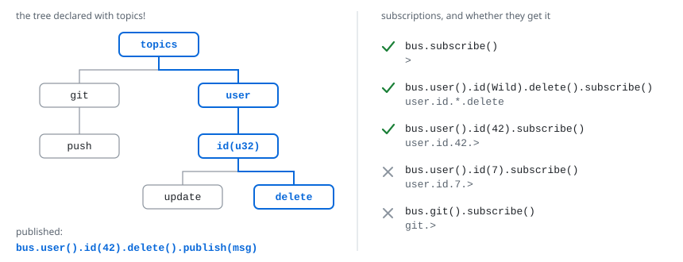

# nattes

[](https://crates.io/crates/nattes)
[](https://docs.rs/nattes)
[](https://github.com/jakumule/nattes/actions/workflows/rust.yaml)
[](LICENSE)

A typesafe, in-process message queue for Rust, inspired by [NATS](https://nats.io).

With string subjects, a typo is a subscription that silently never fires. With
nattes you declare your topics as a tree of types and walk down it, so the
compiler checks every subject, parameter and message type:

```rust,ignore
let mut deletes = bus.user().id(Wild).delete().subscribe().await; // user.id.*.delete
while let Some(msg) = deletes.next().await {
    let (user_id,) = msg.params();
    // msg derefs to &UserDeleteMsg
}
```

```text
bus.user().id(Wild).delet()
    error: no method named `delet` found for struct `Channel<T, P>`

bus.git().push().publish(UserDeleteMsg)
    error: mismatched types: expected `GitPushMsg`, found `UserDeleteMsg`

bus.user().id(Wild).delete().publish(UserDeleteMsg)
    error: no method named `publish` found for struct `Channel<DeleteLeaf, (u32,)>`
```

<p align="center">
  
</p>

<!-- Editor demo: record rust-analyzer completing `bus.user().`, the hover on a
     step (its docs and subject) and the error on a typo, save it as
     assets/editor.gif, then uncomment:
<p align="center"></p>
-->

## Contents

- [Features](#features)
- [Install](#install)
- [Quick start](#quick-start)
- [A short tour](#a-short-tour)
- [Coming from NATS](#coming-from-nats)
- [When to use it](#when-to-use-it)
- [Documentation](#documentation)
- [Status](#status)
- [Contributing](#contributing)
- [License](#license)

## Features

- **Typed subjects.** Topics, parameters and messages are Rust types. There's
  no string parsing and no serialization: subscribers get the published value
  through an `Arc`.
- **NATS-style subscriptions.** Subscribe to everything below a topic (`>`),
  use wildcard parameters (`*`) or fixed ones, join queue groups, and do
  request/reply or scatter-gather.
- **Sub-channels are roots.** A `Channel<topics::git::Topic>` behaves like a bus
  whose root is `git`. A component that takes one works the same standalone or
  mounted inside a bigger tree.
- **Runtime-agnostic.** Every handle and future is `Send + Sync`, subscriptions
  are `futures::Stream`s that unsubscribe when dropped, and nattes depends on
  no executor. A slow subscriber never blocks publishers unless you ask for
  backpressure.
- **Fast paths.** `publish_many` and `recv_many` move many messages per lock,
  and a handler receives on the publisher's thread, without a buffer or a task.
- **Bridges.** Extend a bus over any byte transport (Unix socket, TCP, QUIC, …):
  each side sends only what the other subscribes to, encoded by your codec.
- **Editor-friendly.** Steps are plain methods, so rust-analyzer completes
  them, hovering one shows the topic's docs and subject, and going to its
  definition lands on its line in `topics!`.

## Install

```sh
cargo add nattes
```

| Feature | Adds |
|---|---|
| `tracing` | logs of subscriptions, publishes and lost messages, through [`tracing`](https://docs.rs/tracing) ([guide](https://docs.rs/nattes/latest/nattes/guide/tracing/)) |
| `bridge` | `Bridge`, `Codec`: a bus extended over a byte transport ([guide](https://docs.rs/nattes/latest/nattes/guide/bridges/)) |

Both are off by default. nattes needs Rust 1.85 or later (edition 2024). The
examples here also use `futures` for `StreamExt` and tokio as the runtime; any
executor works.

## Quick start

```rust
use futures::StreamExt;
use nattes::{topics, Channel};

#[derive(Debug)]
pub struct PushMsg {
    pub branch: String,
}

#[derive(Debug)]
pub struct DeleteMsg;

topics! {
    #[derive(Debug)]
    topics {
        git {
            push: PushMsg,
        },
        user {
            id(u32) {
                delete: DeleteMsg,
            },
        },
    }
}
use topics::prelude::*;

#[tokio::main]
async fn main() {
    let bus = Channel::<topics::Topic>::new();

    // git.push
    let pushes = bus.git().push();
    let mut sub = pushes.subscribe().await;

    pushes.publish(PushMsg { branch: "main".into() }).await;

    let msg = sub.next().await.unwrap();
    assert_eq!(msg.branch, "main");
    assert_eq!(msg.subject(), "git.push");
}
```

## A short tour

**Wildcards and levels.** A parameter is fixed, `id(42)`, or a wildcard,
`id(Wild)`. Subscribing on a level gets everything below it, as a `TopicRef`
enum to match on.
[Navigating](https://docs.rs/nattes/latest/nattes/guide/navigating/),
[subscribing](https://docs.rs/nattes/latest/nattes/guide/subscribing/).

```rust,ignore
let mut users = bus.user().id(Wild).subscribe().await; // user.id.*.>
bus.user().id(42).delete().publish(DeleteMsg).await;

let msg = users.next().await.unwrap();
assert_eq!(msg.params(), (42,));
match msg.view() {
    topics::user::id::TopicRef::Delete(delete) => { /* &DeleteMsg */ }
}
```

**Queue groups.** Declared in the tree with `[ … ]`; each message goes to one
member of the group.
[Queue groups](https://docs.rs/nattes/latest/nattes/guide/queue_groups/).

```rust,ignore
topics! { topics { git { push [Indexer(u32)]: PushMsg } } }

let a = pushes.subscribe().queue(PushQueue::Indexer(0)).await;
let b = pushes.subscribe().queue(PushQueue::Indexer(0)).await;
pushes.publish(PushMsg { branch: "main".into() }).await; // to a or to b
```

**Request/reply.** A leaf declared `name: Msg => Reply` takes requests, and
`scatter` gathers a reply from every responder.
[Request/reply](https://docs.rs/nattes/latest/nattes/guide/request_reply/).

```rust,ignore
topics! { topics { git { fetch: FetchMsg => FetchAck } } }

let mut responder = fetches.respond().await;
tokio::spawn(async move {
    while let Some(req) = responder.next().await {
        req.respond(FetchAck { ok: true });
    }
});

let ack = fetches.request(FetchMsg { branch: "main".into() }).await?;
```

**Backpressure, batches, handlers.** Each subscription picks its buffer and
what happens when it's full; the tree can set the defaults.
[Delivery guarantees](https://docs.rs/nattes/latest/nattes/guide/delivery/).

```rust,ignore
let mut jobs = bus.jobs().subscribe().buffer(64).on_full(Overflow::Wait).await;
let _count = bus.metrics().subscribe().handler(|msg| { /* on the publisher's thread */ });
```

**Bridges.** The same tree in two processes, joined by a transport and a codec
of your choice. [Bridges](https://docs.rs/nattes/latest/nattes/guide/bridges/).

```rust,ignore
let socket = tokio::net::UnixStream::connect("/run/app.sock").await?;
let (sink, stream) = Framed::new(socket, LengthDelimitedCodec::new()).split();
Bridge::new(bus.clone(), Bincode).run(sink, stream).await?;
```

## Coming from NATS

| NATS | nattes |
|---|---|
| `>` | `bus.subscribe()` |
| `git.>` | `bus.git().subscribe()` |
| `git.push` | `bus.git().push().subscribe()` |
| `user.id.<alice>.>` | `bus.user().id(alice).subscribe()` |
| `user.id.*.delete` | `bus.user().id(Wild).delete().subscribe()` |
| queue group | `.subscribe().queue(git::Queue::Mailer)` |
| request/reply | `channel.request(msg)` / `channel.respond()`, then `req.respond(reply)` |
| scatter-gather | `channel.scatter(msg)` (a stream of replies) |

## When to use it

nattes fits when the parts of one program talk through events and you want
NATS's subject model with the compiler behind it: a subscriber on `user.>`, a
worker pool on `jobs.resize`, a component that only knows its own subtree.

It is not a broker:

- **In memory, at most once.** Nothing is persisted, acknowledged or
  redelivered. For durable queues, use a broker (NATS JetStream, Kafka, …).
- **One tree, known at compile time.** Subjects can't be built from strings at
  run time. If they must be, use a NATS client.
- **Simpler needs have simpler tools.** For one message type and no subjects,
  `tokio::sync::broadcast` or an `mpsc` channel is enough.

Across processes, a [bridge](https://docs.rs/nattes/latest/nattes/guide/bridges/)
joins buses that share a tree, but delivery stays at most once.

## Documentation

- **[The guide](https://docs.rs/nattes/latest/nattes/guide/)**, on docs.rs, with
  tested examples:
  [declaring topics](https://docs.rs/nattes/latest/nattes/guide/declaring/),
  [navigating](https://docs.rs/nattes/latest/nattes/guide/navigating/),
  [publishing](https://docs.rs/nattes/latest/nattes/guide/publishing/),
  [subscribing](https://docs.rs/nattes/latest/nattes/guide/subscribing/),
  [queue groups](https://docs.rs/nattes/latest/nattes/guide/queue_groups/),
  [request/reply](https://docs.rs/nattes/latest/nattes/guide/request_reply/),
  [bridges](https://docs.rs/nattes/latest/nattes/guide/bridges/),
  [delivery guarantees](https://docs.rs/nattes/latest/nattes/guide/delivery/),
  [tracing](https://docs.rs/nattes/latest/nattes/guide/tracing/),
  [recipes](https://docs.rs/nattes/latest/nattes/guide/recipes/),
  [compile-time checks](https://docs.rs/nattes/latest/nattes/guide/compile_time/),
  [requirements](https://docs.rs/nattes/latest/nattes/guide/requirements/).
- **[API reference](https://docs.rs/nattes)**.
- **[Vocabulary](doc/src/vocabulary.md)**: the terms used in the docs and the code.

## Status

nattes is a preview: the API still changes between minor versions, without
deprecation. Planned work is in [TODO.md](TODO.md).

## Contributing

Issues and pull requests are welcome. `nix develop` (or direnv) gives the
toolchain; before sending a change, run:

```sh
cargo test --workspace --all-features
cargo clippy --workspace --all-features
```

Benchmarks (`cargo bench`) and the layout of the code are described in
[CLAUDE.md](CLAUDE.md).

## License

MIT, see [LICENSE](LICENSE).
